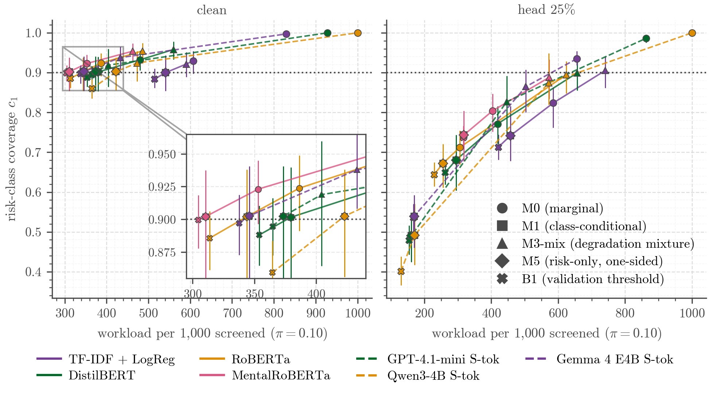

# Safe on Clean Text: How Conformal Mental-Health Screening Fails Quietly

This repository holds the code, predictions and results of a study of split conformal prediction in mental health NLP.
The study uses Dreaddit (stress) and SDCNL (suicidal ideation) at α = 0.10 and tests whether
the marginal 90% guarantee also protects the at-risk class.

- The marginal guarantee holds on clean data for all models.
- Under truncation, risk-class coverage falls below its band for the trained models, and class-conditional calibration
  is worse than marginal calibration for the risk class for all 7 models.
- Prevalence shift lowers marginal coverage substantially only for the zero-shot LLMs.
- On clean data, class-conditional calibration has a lower workload than marginal calibration. The workload cost
  belongs to matched or mixture calibration under degradation.



The study is methodological and uses public proxy datasets. It is not a clinical tool.

## Results

Dreaddit was analysed with 7 models (TF-IDF, DistilBERT, RoBERTa, MentalRoBERTa, and the zero-shot LLMs Qwen, Gemma
and GPT). SDCNL used 3 models.

| | Hypothesis | Outcome |
| --- | --- | --- |
| H1 | Marginal coverage lies in its band, and the two class coverages differ by ≥ 0.05 | confirmed (5 of 7) |
| H2 | At prevalence 0.05 / 0.10, marginal coverage drops below 0.87 while class-conditional coverage stays at 0.90 ± 0.02 | not confirmed (marginal part 3 of 7) |
| H3a | Truncation to the first 25% of words pushes risk-class coverage below its band | confirmed (4 of 7) |
| H3b | Class-conditional calibration does worse than marginal for the risk class under truncation | confirmed (7 of 7) |
| H3c | Mixture calibration keeps risk-class coverage in its band in all 11 conditions | not confirmed (2 of 7) |
| H4 | In leave-one-domain-out, the worst domain falls below its band | confirmed |
| H5 | The best zero-shot LLM has a higher workload than RoBERTa, and verbalised confidence a higher workload than token probabilities | confirmed* |
| H6 | Full prediction sets flag posts with non-unanimous annotations (AUROC > 0.60) | confirmed |
| R1–R3 | SDCNL replication of H1–H3 | R1, R3b, R3c confirmed (R2, R3a not) |
| H7 | At matched clean workload, class-conditional calibration still covers fewer at-risk posts than marginal calibration under degradation | not confirmed (27 of 70 cells, all from the 3 LLMs, which cannot be matched)† |
| H8 | With the calibration risk class thinned to 10%, the marginal threshold keeps its slack over the class-conditional one | confirmed (7 of 7) |
| H9 | Under truncation, matched calibration (M3) costs at most 1.25 times the oracle workload | confirmed (7 of 7)‡ |
| H10 | Weighted conformal prediction with a mixture source keeps risk-class coverage in its band | confirmed (6 of 7) |
| H11 | Calibrated on long posts, class-conditional risk-class coverage falls below its band on naturally short posts | not confirmed (1 of 7)§ |
| H12 | Truncating long calibration posts predicts that coverage on short posts without test labels | not confirmed (1 of 7) |
| H13 | Mixture calibration on degraded long posts keeps risk-class coverage on short posts in its band | confirmed (7 of 7) |

\* The difference between the best LLM and RoBERTa is not distinguishable from zero (2.9 per 1,000 screened, 95%
interval −46 to +52).

† For the 4 trained models, M1 at the matched α′ has a higher median risk-class coverage than M0 in all 40 degraded
cells, with the 2.5% end above 0 in 30 of them. For the LLMs, no α down to 0.02 brings M1's workload up to M0's, so
their cells compare unequal workloads.

‡ At these calibration sizes the oracle threshold is the same order statistic as M3's risk-class threshold, so the
ratio is 1.00 by construction.

§ Qwen's median c₁ (0.8125, 65 of 80 short risk posts) equals the lower end of the band, so it does not count as below.

H7–H10 values are in [`results/paper/tables/table7_hypotheses_h7_h10.csv`](results/paper/tables/table7_hypotheses_h7_h10.csv)
and H11–H13 values in [`results/paper/tables/table8_hypotheses_h11_h13.csv`](results/paper/tables/table8_hypotheses_h11_h13.csv).

### Criteria H7–H10 (fixed before running)

These criteria were fixed on 2026-10-19, before the analyses were run. All four use Dreaddit, the same 7 models,
α = 0.10 and 1,000 grouped resplits. Encoders are averaged over their seeds within each resplit, and workload is the
share of posts not dismissed at risk prevalence π = 0.10. Results are medians with 2.5–97.5% ranges over resplits.

- H7 (matched workload). M1 at α′ still covers fewer at-risk posts than M0 at α = 0.10. α′ is chosen on the
  calibration half of each resplit (for each encoder seed). It is the value of the grid α = 0.02, 0.03, …, 0.20 nearest
  to 0.10 at which M1's clean workload on the calibration half is not lower than M0's, the smaller α on a tie. A cell is
  losing when the 97.5% end of the paired difference c₁(M1 at α′) − c₁(M0) over resplits is below 0. H7 is met if at
  least 36 of the 70 degraded cells (7 models × 10 degraded conditions) are losing.
- H8 (calibration at 10% risk). In each resplit the risk class of the calibration half is thinned to
  round(0.10 · n₁) rows, drawn without replacement once per resplit and shared by all models. The test half is
  unchanged. H8 is met if, for at least 4 of 7 models, q̂_M1 < q̂_M0 (M1's risk-class threshold against M0's threshold)
  in more than 50% of resplits and the median clean c₁(M0) on the test half is above 0.90. Resplits with
  q̂_M1 = q̂_M0 count on neither side and are reported separately. Shares are taken over (seed, resplit) pairs. M0-LS
  targets the test half's risk share.
- H9 (oracle cost). The oracle flags a post when its risk score is at most t, the ⌈0.9 · n₁⌉-th smallest risk score
  of the calibration half in the same condition (the smallest threshold with c₁ ≥ 0.90 on calibration, uncorrected as
  in B1), and dismisses it otherwise. H9 is met if, under head_25, the median over resplits of the ratio of M3 workload
  to oracle workload (both seed-averaged within each resplit) is at most 1.25 for at least 4 of 7 models.
- H10 (weighted conformal, mixture source). Weighted split conformal prediction (Tibshirani et al., 2019). The
  domain classifier is a logistic regression fitted on the validation split only. Its source is the validation posts
  degraded as for M3-mix (one random condition per post) and its target is the same posts in the test condition, so
  the classes are balanced and the odds equal the density ratio. The features are word count and the share of
  lower-cased words outside the training vocabulary, computed on validation texts degraded by the existing
  degradation code. Weights use text features only; shifts in model scores at fixed length and vocabulary are not
  corrected. In the main variant (a) the weights are applied to the M3-mix calibration set. H10 is met if, under the
  class-conditional version of (a), the median c₁ is inside its band (at the median risk-class calibration and test
  sizes, as in H3c) in at least 9 of 11 conditions for at least 4 of 7 models. The marginal version and variant (b),
  with clean validation posts as the source and the weights applied to the clean calibration set, are descriptive.

### Criteria H11–H13 (fixed before running)

These criteria were fixed on 2026-10-20, before any coverage on naturally short posts was computed. They use the same
data, models, α, resplits, seed averaging and workload definition as H7–H10. Dreaddit excerpts are cut from longer
posts ("We partition the posts into contiguous five-sentence chunks for labeling", Turcan and McKeown, 2019, §3.2), so
short excerpts are a natural counterpart of truncation. Length is the clean word count. Long posts have at least the
pool median (81 words) and short posts at most the pool lower quartile (65 words), both over calibration and test
together. The truncation level k = 50 was chosen mechanically as the level of {75, 50, 25} whose median truncated
length of long posts (51 words) is closest to the median length of short posts (55 words).

- H11 (natural shift). M0 and M1 are calibrated on the long clean posts of the calibration half and tested on the
  short clean posts of the test half. H11 is met if the median c₁ of M1 is below the lower end of its band for at least
  4 of 7 models. The band is the c₁ reference band at the median long risk count of the calibration half and the median
  short risk count of the test half.
- H12 (prediction from synthetic truncation). Within the calibration half, the long posts are split at random into
  halves A and B by post, and each long post is cut to its first or last 50% of words with probability ½ (head_50 or
  tail_50). Both draws are made once per resplit and shared by all models. M1 is fitted on clean A, and the predicted
  c₁ is the share of B's risk posts, in their truncated versions, whose risk label is in the set. A and B are then
  swapped and the two predictions averaged, so no test labels are used. H12 is met if, for at least 4 of 7 models, the
  median predicted c₁ is within ±0.05 of the median observed c₁ of M1 from H11 and closer to it than the naive
  prediction 0.90.
- H13 (mixture calibration). M3-mix is calibrated on the long posts of the calibration half, each in its M3-mix
  condition, with (length bucket, class) groups, and tested on the short clean posts of the test half. H13 is met if
  the median c₁ of M3-mix is inside the band of H11 for at least 4 of 7 models.

The full criteria and values are in [`results/paper/tables/table6_hypotheses.csv`](results/paper/tables/table6_hypotheses.csv).
[`results/paper/results_digest.md`](results/paper/results_digest.md) lists every number in the paper with its source file.

## How to reproduce

Reproduction starts from the committed predictions and LLM answers and rebuilds every analysis, table and figure from them.

0. You need a Mac with Apple silicon (tested on a MacBook Air M2 with 16 GB RAM), about 3 GB of free disk space and an
   internet connection for the datasets and packages. Plan for about one hour in total. Neither a GPU nor API keys are
   required.
1. Install uv, the Python package manager, with `curl -LsSf https://astral.sh/uv/install.sh | sh`. This works on macOS
   and Linux, and [uv's docs](https://docs.astral.sh/uv/) describe other options. The installer finishes within seconds,
   after which `uv --version` prints a version number.
2. Clone the repository with
   `git clone https://github.com/realoleg/safe-on-clean-text.git && cd safe-on-clean-text`.
   In under a minute you have a folder containing `README.md`, `src/` and `results/`.
3. Run `uv sync` to install the dependencies. It fetches Python 3.11 if your machine lacks it and creates `.venv/`
   (about 1 GB). Expect a few minutes. When it is done, uv prints the list of packages it installed.
4. Start the full rebuild with `uv run safe-on-clean-text reproduce`. The command downloads Dreaddit (Hugging Face) and
   SDCNL (GitHub) at pinned versions, prepares the splits and degraded texts, runs the evaluation and writes the paper
   outputs. Progress is printed stage by stage over about 60 minutes, and the run ends without an error.
5. Check the outcome with `git status`. It should report
   `nothing to commit, working tree clean`, because every regenerated file is byte-identical to the committed one.
   Tables go to `results/paper/tables/` and figures to `results/paper/figures/`. Every cited number is listed in
   `results/paper/results_digest.md`.

The full study ran on macOS with Apple silicon, where CI also runs lint, data preparation and the tests. On Ubuntu, CI
installs the package and runs the tests, and tests that need the prepared data are skipped there. `reproduce` has only
been run on macOS. On x86-64, quantiles computed by pandas can differ in the last bit, so byte-identical outputs are
expected only on Apple silicon.

### Running the stages one at a time

| Command | What it does | Time |
| --- | --- | --- |
| `uv run safe-on-clean-text prepare` | downloads both datasets and writes the splits, degraded texts, manifests and checksums | < 1 min |
| `uv run safe-on-clean-text evaluate` | runs the conformal methods on 1,000 resplits, plus the checks and the prevalence, domain-shift and mechanism analyses | ~58 min |
| `uv run safe-on-clean-text paper` | writes the tables, figures, captions and digest to `results/paper/` | ~1 min |
| `uv run pytest` | runs the tests (`-m network` adds the data-preparation test). Data tests are skipped until `prepare` has run | ~10 s |

### Full retraining

The paper's numbers do not depend on retraining. Retraining itself needs Apple silicon, because the encoders train
with MPS and the local LLMs run with MLX.

| Command | Time (M2) |
| --- | --- |
| `safe-on-clean-text train baselines [--config configs/sdcnl.yaml]` | seconds |
| `safe-on-clean-text train encoders` (Dreaddit) / `--config configs/sdcnl.yaml` (SDCNL, DistilBERT only) | ~4 h / ~30 min |
| `safe-on-clean-text train lodo` | ~50 min |
| `safe-on-clean-text llm run --model qwen \| gemma \| gpt`, then `safe-on-clean-text llm export` | ~8 h / ~9 h / ~1.5 h |

Put the keys in `.env`, following `.env.example`. GPT needs `OPENAI_API_KEY` for its paid API calls (about $2 in
total), and MentalRoBERTa needs `HF_TOKEN` because it is a gated model on Hugging Face. Complete runs are skipped and
cached LLM answers are never requested again, so an interrupted command resumes where it stopped. To redo a run, move
its folder or cache file away first. Encoder training on MPS is not bit-identical between runs. Clean metrics
reproduce, but probabilities drift by up to about 0.02.

## Use it on your own model

```shell
uv run safe-on-clean-text prepare
uv run safe-on-clean-text report results/runs/dreaddit/tfidf_logreg/seed_42/predictions.csv.gz --output-dir my_report
```

The `report` command reads one predictions file in the format of `results/runs/` and recomputes the conformal
metrics for it. The example uses the stored TF-IDF predictions. The file needs one row per (id, split, condition) for
the dataset's calibration and test ids, with the columns `id`, `split`, `condition`, `label` (1 = risk class), `n_words`
(from `safe_on_clean_text.text.word_count`), `prob_stress`, `logit_stress` and `logit_not_stress`. On both datasets,
"stress" in these names means the risk class. For every condition and method the report gives coverage, c₀, c₁, the
share of resplits with c₁ below its band, and workload and referrals per 1,000 screened. Add
`--config configs/sdcnl.yaml` to run it on SDCNL.

## Repository layout

| Path | Content |
| --- | --- |
| `src/safe_on_clean_text/` | the package and the `safe-on-clean-text` command |
| `configs/` | all settings (`dreaddit.yaml`, overridden by `sdcnl.yaml`) |
| `data/manifests/`, `data/processed/<dataset>/` | split ids, checksums and data reports (no post text) |
| `results/runs/<dataset>/<model>/seed_<s>/` | per-example predictions and `run_meta.json` of every run |
| `results/llm/<dataset>/` | cached LLM answers, run summaries and diagnostics |
| `results/evaluation/<dataset>/` | working summaries with an encoder's seeds pooled (the paper's numbers come from `results/paper/`) |
| `results/checks/` | validation checks of the conformal code |
| `results/paper/` | paper tables, figures, captions and the results digest |

The `run_meta.json` files were written during development and are kept unchanged as records. They may reference earlier
script names and commits of the private development history.

## Methods and terms

| Label | Method |
| --- | --- |
| M0 | marginal calibration with one threshold over all calibration examples |
| M1 | class-conditional calibration with one threshold per class |
| M2 | one threshold per (domain, class) |
| M3 | matched calibration, class-conditional on texts with the test's degradation |
| M3-mix | mixture calibration per (length bucket, class) on a random mixture of degradations |
| M5 | risk-only rule that flags a post when the risk class passes its threshold and dismisses it otherwise |
| M0-LS | M0 with label-shift weights for a known risk prevalence |
| B1 | risk-score threshold set on validation risk cases without conformal correction |
| B2 | temperature-scaled argmax that abstains on as many posts as M1 refers |
| B3 | M0 and M1 on the mean probability of an encoder's five seeds |

The prediction set decides the action. A set {risk} flags the post and {not risk} dismisses it. Full or empty sets refer
the post to a human. **Workload** per 1,000 screened counts every post that is not dismissed. **Referrals** count only
the full or empty sets. c₀ and c₁ are the coverages of the not-risk and the risk class.

## Data, models and licences

| Model | Source | Revision |
| --- | --- | --- |
| DistilBERT | Hugging Face `distilbert-base-uncased` | `12040accade4e8a0f71eabdb258fecc2e7e948be` |
| RoBERTa | Hugging Face `roberta-base` | `e2da8e2f811d1448a5b465c236feacd80ffbac7b` |
| MentalRoBERTa | Hugging Face `mental/mental-roberta-base` | `610e9d35d8f2550d713579077242d5e523209cea` |
| Qwen3-4B (4-bit MLX) | Hugging Face `mlx-community/Qwen3-4B-Instruct-2507-4bit` | `50d427756c6b1b2fe0c0a10f67fbda1fc8e82c1b` |
| Gemma 4 E4B (4-bit MLX) | Hugging Face `mlx-community/gemma-4-e4b-it-OptiQ-4bit` | `e1404a83551b6eb571dc5fb0de93e52310399bcd` |
| GPT-4.1 mini | OpenAI API | snapshot `gpt-4.1-mini-2025-04-14` |
| NLTK punkt_tab (occlusion) | GitHub `nltk/nltk_data` | commit `4f15a3d` |

The Hugging Face revisions were read from the local model cache after the runs. The MentalRoBERTa cache also held a
second snapshot (`115edd28…`) downloaded seconds before.

- Dreaddit (Turcan & McKeown, 2019) comes from Hugging Face `asmaab/dreaddit` at revision `172a8a1`. Its dataset card
  declares no licence.
- The SDCNL data (Haque et al., 2021) are downloaded from the authors' GitHub repository at a pinned commit and
  SHA-256. That repository has no licence file.
- MentalRoBERTa (Ji et al., 2022) carries a CC BY-NC 4.0 licence. Its pretraining corpus includes r/Anxiety, which
  overlaps Dreaddit's anxiety domain.
- No committed file contains post text. `prepare` downloads the datasets and the outputs hold ids only. The LLM cache
  stores a hash of each prompt.

Implementation notes:

- Encoders reload the best checkpoint and convert its tensor names, because transformers 5.3 left LayerNorm tensors at
  their last-epoch values. Each run then compares the reloaded model with the checkpoint tensor by tensor.
- Nonconformity scores are log-odds, s_y = log p_other − log p_y. They give the same sets as LAC (1 − p_y) and avoid
  float64 rounding near 0 and 1.
- RoBERTa, MentalRoBERTa and SDCNL DistilBERT hit Metal out-of-memory errors at batch 16. They train with batch 8 and 2
  accumulation steps, which leaves the effective batch unchanged.
- For S-verb, the numeric-probability instruction replaces the answer-format sentence of the prompt instead of being
  appended to it.

## Citation and licence

To cite this work, use [`CITATION.cff`](CITATION.cff). It also lists the datasets, models and methods to cite. The code
is released under the MIT licence ([`LICENSE`](LICENSE)).
